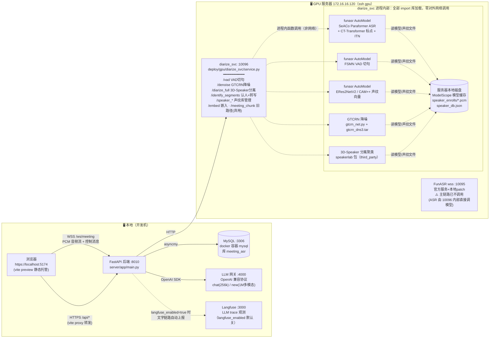
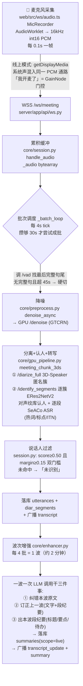
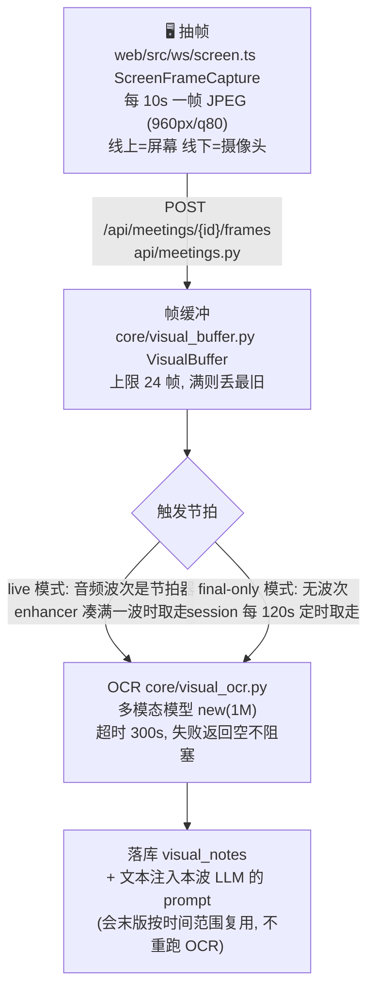
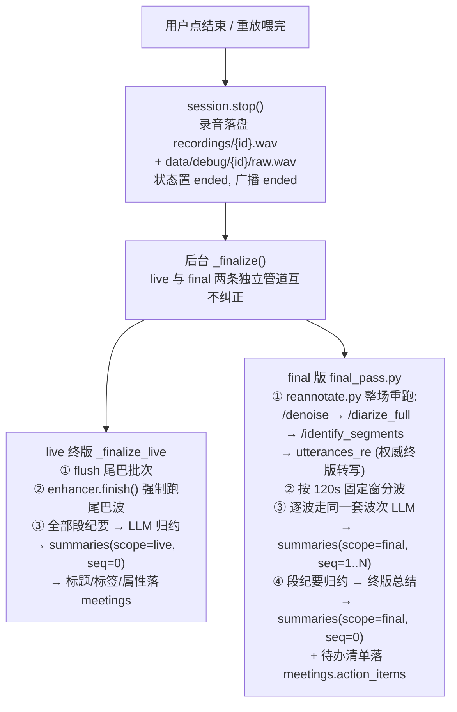
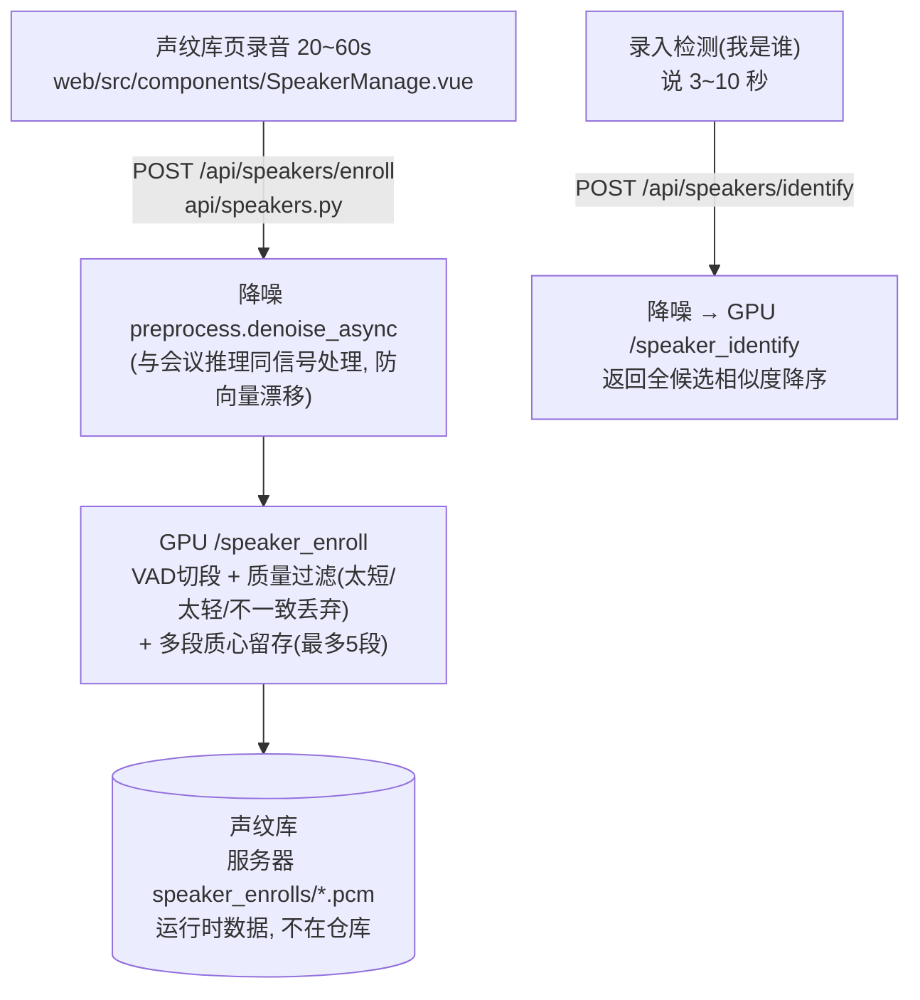
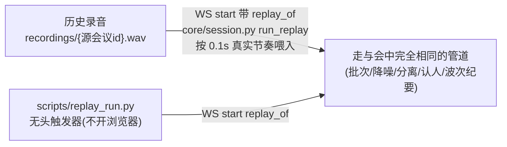
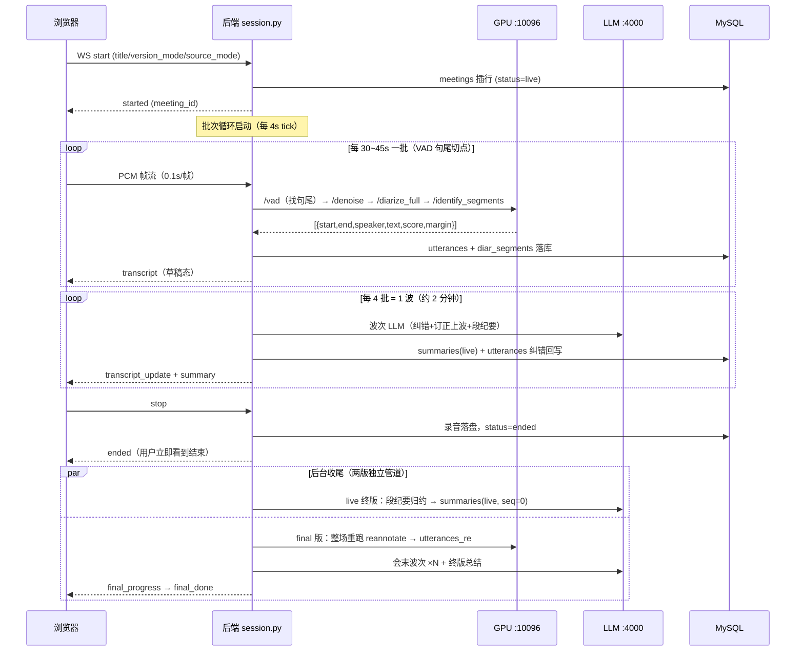
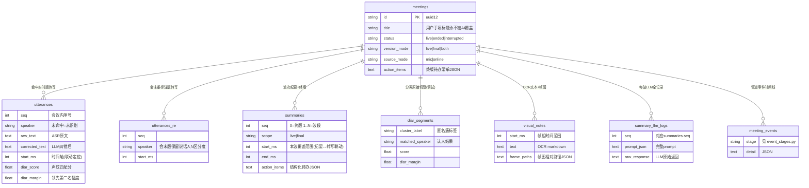

# 系统架构全景图（2026-09-30）

> 本文是会议纪要系统的架构总览，五张图由粗到细：
> ① 服务拓扑 → ② 输入输出流程（带代码文件） → ③ 目录结构 → ④ 会议生命周期时序 → ⑤ 数据库表。
> 所有内容均对照当日代码核实；**2026-09-30 架构改造**（全部运算上 GPU 服务器、本地零 torch）后的状态。

---

## ① 服务拓扑图



要点：

- **本地零 torch**（2026-09-30 改造）：降噪、分离、ASR、声纹认人全部在 GPU 服务器；本地后端只做编排（WS 收发、HTTP 调用、写库）。
- LLM 网关 `:4000` 是 OpenAI 兼容代理，后面挂内网 vLLM / 外部 API 均可，后端无感知。
- FunASR 官方 wss 服务（10095）目前**不在主链路**上，仅保留（历史声纹注册管理曾用它）。
- diarize_svc（10096）**完全自包含**：ASR/VAD/声纹/降噪/分离全部以库形式 import 进自己进程（`funasr.AutoModel` / `gtcrn_net` / `speakerlab`），权重读本地磁盘；不调用任何其他服务——不打 10095、不打 LLM 网关、不连数据库。
- GPU 机器 IP 会变：改 `.env` 的 `DIARIZE_HTTP_URL` 即可，不用改代码。

---

## ② 输入输出流程图（带代码文件）

### 2.1 会中实时版（live）——音频通路



### 2.2 视觉通路（屏幕/摄像头 → OCR）



### 2.3 会末版（final）——会议结束后重跑



### 2.4 声纹注册 / 检测通路



### 2.5 重放测试通路（开发调试）



---

## ③ 目录结构图（问题定位地图）

```
meeting-asr/
├── server/                          # 后端（本地运行，纯编排，零 torch）
│   ├── app/
│   │   ├── main.py                  # FastAPI 入口：建表 + 残留 live 会议 sweep
│   │   ├── config.py                # ★ 全部可调参数唯一出处（阈值/批次/超时/开关）
│   │   ├── api/
│   │   │   ├── ws.py                # WS 协议：start/stop/pause/resume + PCM 上行
│   │   │   ├── meetings.py          # 会议列表/详情/纪要/录音/帧上行/手动重标注
│   │   │   ├── speakers.py          # 声纹注册/检测/段试听/删除（转发 GPU）
│   │   │   └── debug.py             # 调试管道数据接口（事件/切段/帧/LLM日志）
│   │   ├── core/
│   │   │   ├── session.py           # ★ 会议生命周期编排：批次循环/落库/广播/收尾
│   │   │   ├── gpu_pipeline.py      # GPU HTTP 客户端：vad/diarize_full/identify_segments
│   │   │   ├── preprocess.py        # 降噪统一入口（remote=GPU /denoise，local=兜底）
│   │   │   ├── enhancer.py          # ★ 波次增强：纠错+订正+段纪要（一波一次 LLM）
│   │   │   ├── reannotate.py        # 会末整场重跑（降噪→分离→认人转写）
│   │   │   ├── final_pass.py        # 会末版管道：分波→波次LLM→终版总结
│   │   │   ├── segment.py           # UtteranceBuffer 句子缓冲 + 显示层合并
│   │   │   ├── visual_buffer.py     # 视觉帧缓冲（24 帧上限）
│   │   │   ├── visual_ocr.py        # 帧组 → 多模态 LLM → markdown
│   │   │   ├── audio_storage.py     # 录音/切段/帧落盘（data/debug/{meeting_id}/）
│   │   │   ├── diarize3ds.py        # 旧本地 3D-Speaker（已退役，仅回滚参考）
│   │   │   └── gtcrn_net.py         # GTCRN 网络定义（同文件部署到 GPU 服务器）
│   │   ├── llm/
│   │   │   ├── client.py            # OpenAI 客户端 + 终版归约/待办去重
│   │   │   └── prompts.py           # 全部 LLM 提示词
│   │   └── db/
│   │       ├── models.py            # ★ 8 张表定义（见⑤）
│   │       ├── database.py          # asyncmy 连接 + 建表
│   │       ├── events.py            # 管道事件埋点写入
│   │       └── event_stages.py      # 事件 stage 常量
│   ├── recordings/                  # 会议整轨录音 {meeting_id}.wav（运行时数据）
│   ├── data/debug/{meeting_id}/     # 调试产物：raw.wav/降噪轨/切段/帧图
│   ├── models/                      # gtcrn_dns3.tar（本地兜底用）
│   └── third_party/3D-Speaker/      # 分离算法源码（部署到 GPU 服务器用）
├── web/                             # 前端 Vue3 + 自研设计系统（无组件库）
│   └── src/
│       ├── App.vue                  # ★ 全部业务状态 + WS 消息处理
│       ├── components/              # Recorder(开会) LiveTranscript(转写流)
│       │                            # SummaryPanel(纪要时间线) MeetingList(历史)
│       │                            # MeetingDetail(详情三Tab) SpeakerManage(声纹库)
│       │                            # DebugPanel(调试管道)
│       ├── ws/                      # client.ts(WS协议) audio.ts(采集) screen.ts(抽帧)
│       └── ui/                      # tokens.css(设计token) format.ts(时间格式)
│                                    # + 图标/toast/modal/toggle 自研组件
├── deploy/gpu/                      # ★ GPU 服务器代码（2026-09-30 收编，唯一权威）
│   ├── README.md                    # 全新服务器部署步骤
│   ├── diarize_svc/service.py       # 服务器核心服务 :10096（1595 行）
│   └── funasr/                      # FunASR 官方服务 patch + 启动脚本
├── scripts/
│   ├── start_all.sh                 # ★ 本地全栈一键起停（后端8010+前端5174）
│   ├── replay_run.py                # 无头重放触发器（WS 脚本）
│   └── init_mysql.sh                # MySQL 初始化
├── eval/                            # 评测资产（AISHELL 数据/真值/调参脚本）
├── docs/achit/                      # 架构文档（本文在这）
├── .env                             # 本地配置（gitignored）
└── .env.server                      # 服务器部署配置（入库，同构键名）
```

---

## ④ 会议生命周期时序图



状态机：`live`（进行中）→ `ended`（正常结束）｜后端启动时把上次进程残留的 `live` 扫成 `interrupted`（已中断，main.py sweep）。

---

## ⑤ 数据库表关系图（MySQL meeting_asr）



---

## 附：关键数字（2026-09-30 定档）

| 参数 | 值 | 位置 |
|---|---|---|
| 批次大小 | 30s 攒批 / 45s 硬切 / 4s tick | config.py pipeline_batch_* |
| VAD 句尾静音 | 250ms（800 证伪：揉团 DER 48.8%） | config.py pipeline_vad_max_end_silence_ms |
| 声纹认人双门槛 | score ≥ 0.50 且 margin ≥ 0.15 | config.py reannotate_name_threshold / pipeline_min_identify_margin |
| 波次 | 4 批/波（约 2min），带前 5 波上下文 | config.py summary_every_n_batches / summary_context_segments |
| 会末分波 | 120s 固定窗 | config.py final_wave_sec |
| LLM | chat（256k）文字链路；new（1M 多模态）OCR | config.py llm_model / visual_llm_model |
| 抽帧 | 10s/帧，960px，JPEG q80，缓冲 24 帧 | config.py visual_* |
